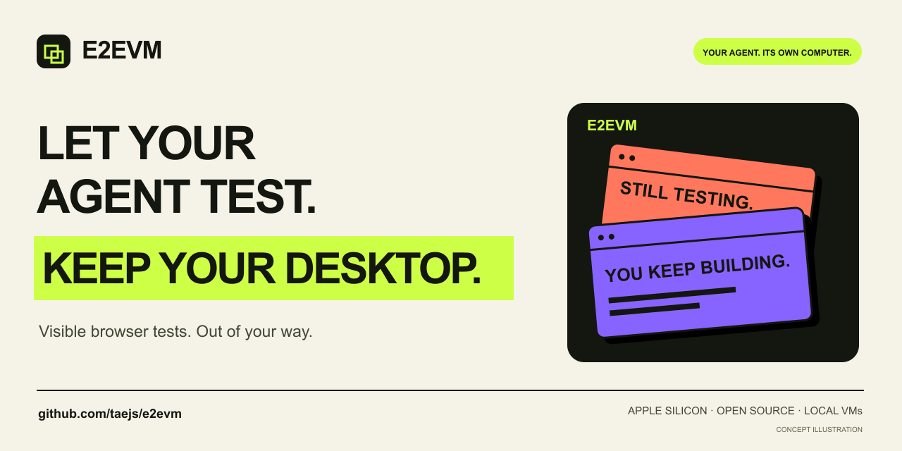

# taejs

### [E2EVM](https://github.com/taejs/e2evm)

A separate desktop for your agent’s browser tests. Run a visible browser, project tools and E2E checks in a local Linux VM while you keep using your Mac.

Connect your existing CLI-capable agent with the included skill, instructions and example prompts. Inspect the guest in a native window; keep project files and the browser profile on its disk.

**Apple Silicon · macOS 14+ · MIT · Early source preview**

[Build and try it](https://github.com/taejs/e2evm#build-and-open-your-first-machine) · [Agent guide](https://github.com/taejs/e2evm/blob/feat/vm-workspace/docs/agents.md) · [Actual app screenshot](https://github.com/taejs/e2evm/blob/feat/vm-workspace/docs/images/workspace.png)

---

[X / @taeshindev](https://x.com/taeshindev)
